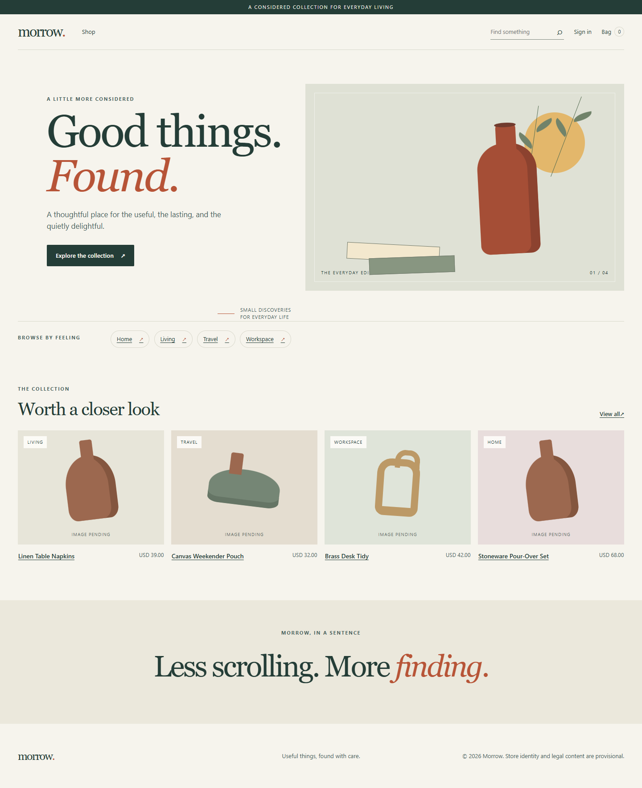
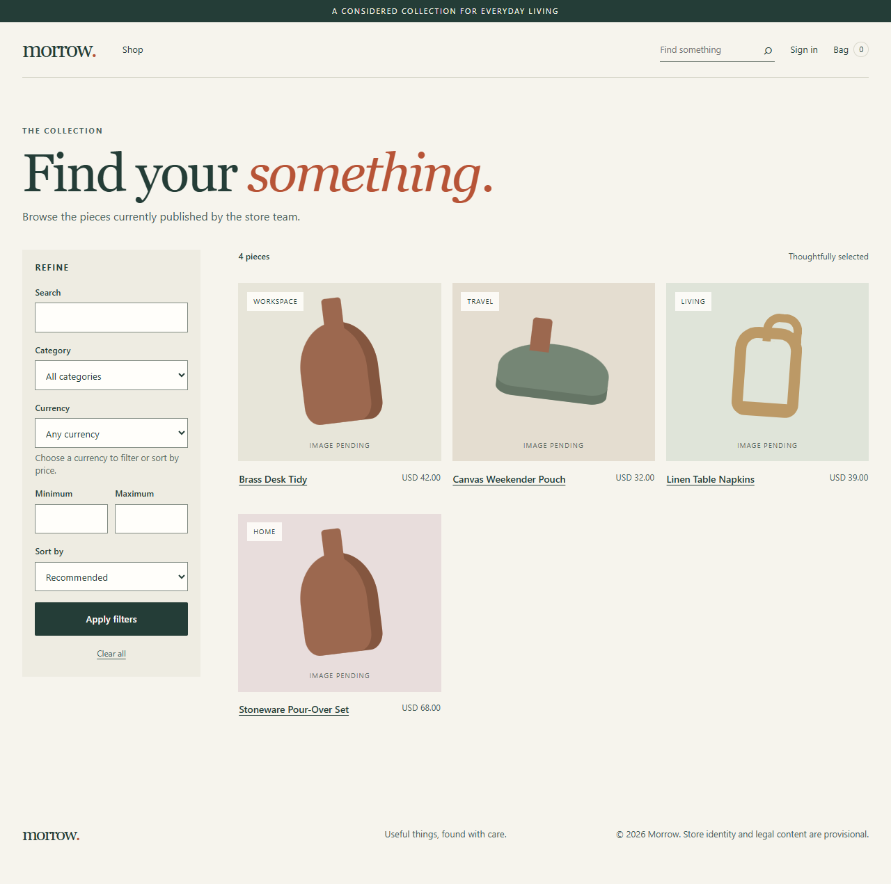
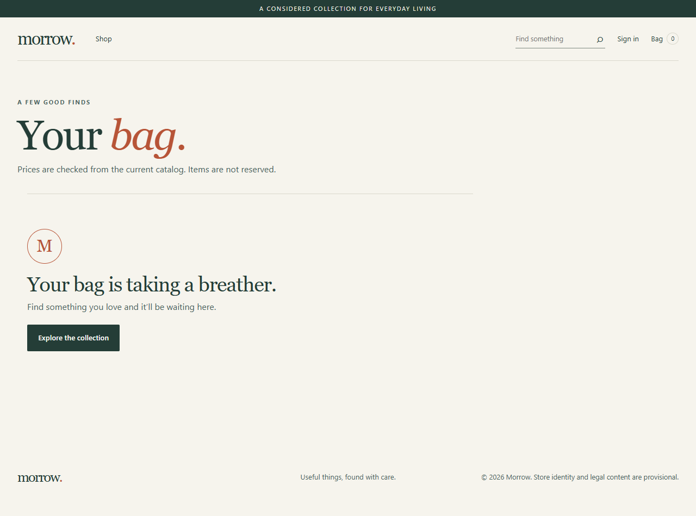
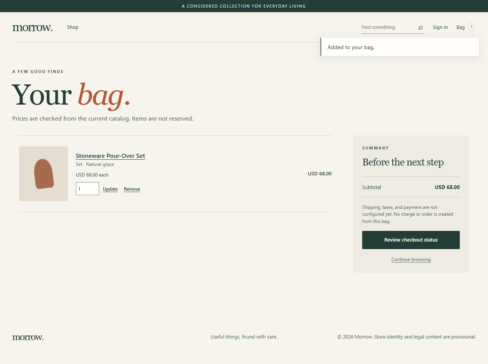

# Morrow

Morrow is an original, server-rendered e-commerce platform under development. The current build provides a curated catalog, search and filters, customer accounts, saved products, and a session-backed bag. Checkout is deliberately closed until the store's market, shipping/tax rules, and verified payment providers are configured. The working brand name and copy are provisional.

## Quick start

Requirements: Python 3.11.

```powershell
python -m venv .venv
.\.venv\Scripts\python.exe -m pip install -r requirements-dev.txt
Copy-Item .env.example .env
.\.venv\Scripts\python.exe manage.py migrate
.\.venv\Scripts\python.exe manage.py runserver
```

Open `http://127.0.0.1:8000/`. The local `.env` is ignored by Git. Use a unique `DJANGO_SECRET_KEY`, `DJANGO_DEBUG=false`, a PostgreSQL `DATABASE_URL`, trusted hosts/origins, and TLS-proxy configuration for deployment. The development `.env.example` values must never be used in production.

Create an admin account with:

```powershell
.\.venv\Scripts\python.exe manage.py createsuperuser
```

Add products in `/admin/`. Products start as drafts and appear in the public catalog only after a staff member sets publication status to **Published**. Variants need an explicit currency, integer minor-unit price, and known available quantity. Supplier-observed inventory must have a recent observation; an unknown or stale observation cannot be added to the bag.

## Storefront preview

The screenshots below were captured from the local development server with a small, local-only demo catalog. They provide a visual reference for the public storefront; they do not represent live supplier inventory, checkout, or payment processing.

### Home



### Collection



### Product detail



### Shopping bag



## Docker Compose with PostgreSQL

```powershell
Copy-Item .env.example .env
docker compose up --build
docker compose exec web python manage.py migrate
docker compose exec web python manage.py createsuperuser
```

This Compose file is for local development only. It runs Django's development server with PostgreSQL. The Docker image uses Gunicorn and production static assets. Production deployments must run migrations as a controlled release step, terminate TLS at a trusted proxy, persist PostgreSQL data, configure backups, and provide application secrets through a secret manager.

## Commands

| Command | Purpose |
|---|---|
| `python manage.py runserver` | Local development only |
| `python manage.py migrate` | Apply database migrations |
| `python manage.py test` | Run automated tests |
| `python manage.py check` | Run Django configuration checks |
| `python manage.py check --deploy` | Check deployment security settings |
| `python manage.py makemigrations --check --dry-run` | Detect model changes without migrations |
| `ruff format .` | Format Python files |
| `ruff check .` | Run Python lint checks |
| `pip-audit -r requirements.txt` | Scan locked runtime dependencies |

## Current functionality

- Published product listing, categories, search, filters, pagination, product details, and a versioned read-only catalog API.
- Email-based registration, login/logout, password reset, and owner-scoped saved products.
- Server-derived cart totals, variant availability checks, quantity caps, mixed-currency protection, and supplier-stock freshness checks.
- Internal idempotent order snapshot service, immutable line pricing, distinct payment/fulfillment fields, and owner-scoped order history.
- Stripe Checkout and PayPal Orders v2 server adapters, signed webhook endpoints, provider transaction IDs, and internal idempotent payment state handling; customer checkout remains disabled pending store rules and sandbox verification.
- Immutable per-unit points ledger, paid-order idempotency, compensating reversals, owner-scoped history, and two-person adjustment requests; rewards stay disabled until their terms are approved.
- Delivered-purchase reviews with customer edits, pending moderation, audited moderator decisions, and approved-only product summaries.
- Giveaway drafts, separately approved rules and activation, limited free entry, immutable ticket/audit records, and independently approved cryptographic drawings; all public giveaway flows default off.
- Responsive original storefront design, autoescaped product descriptions, health endpoints, and browser security headers.
- Django Admin product/category management with explicit draft/review/published states.

The customer checkout route does not create an order or accept delivery information. The order snapshot service is an internal foundation and requires a trusted server-side shipping/tax quote; it is not called by checkout. No payment is taken. Points and giveaways remain disabled pending policy approval. Giveaway entry from purchase or points, automatic activation/closure, and winner notifications are not connected. Review abuse reporting and moderation operations, live supplier synchronization, refunds, and active fulfillment also remain unfinished.

## Architecture and module boundaries

See [architecture](docs/architecture.md), [ADR-0001](docs/decisions/0001-django-modular-monolith.md), and the [implementation plan](tasks/plan.md). The application is a Django modular monolith with PostgreSQL in deployed environments and SQLite for quick local tests. The browser talks to server-rendered HTML and a versioned `/api/v1/` JSON catalog surface.

## Configuration and operations

- Environment reference: [.env.example](.env.example)
- Variable descriptions: [docs/environment.md](docs/environment.md)
- API contract: [docs/api.md](docs/api.md)
- Security posture: [docs/security.md](docs/security.md)
- Operations and recovery: [docs/operations.md](docs/operations.md)
- Supplier permissions/setup gate: [docs/aliexpress-integration.md](docs/aliexpress-integration.md)
- Payment setup gate: [docs/payments.md](docs/payments.md)
- Points policy and ledger: [docs/points.md](docs/points.md)
- Verified purchase review behavior and remaining policy: [docs/reviews.md](docs/reviews.md)
- Staff permissions and separation of duties: [docs/role-matrix.md](docs/role-matrix.md)
- Giveaway approval, entry, draw controls, and launch gates: [docs/giveaways.md](docs/giveaways.md)
- Outstanding decisions and launch gates: [docs/launch-gates.md](docs/launch-gates.md)

## Verification status

The current SQLite suite is executable with `python manage.py test`. CI is configured to run the checks against PostgreSQL 17. Live API/provider integration, deployment, accessibility auditing, and Lighthouse measurements must be recorded only when performed with authorized credentials and a representative deployment.
